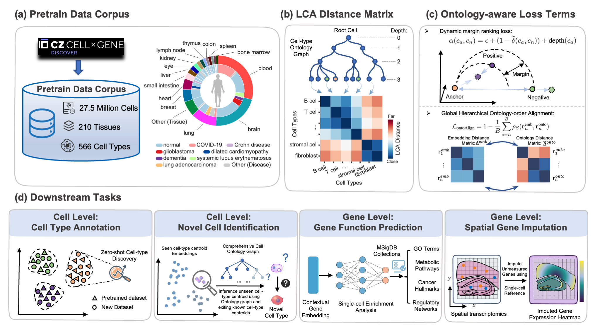

# scOntoFM: Learning Biological Hierarchies in Single-Cell Foundation Models

**scOntoFM** is a novel biologically informed foundation model that explicitly integrates hierarchical cell ontology 
into representation learning. Our approach consistently improves performance across diverse downstream tasks, 
but also significantly improves the preservation of biological structure, offering a more robust tool for single-cell analysis.

<p align="center">
  
</p>

*Figure: (a) pretraining corpus; (b) cell ontology graph and its LCA distance matrix;
(c) ontology-aware objectives; (d) downstream tasks.*

---

## Contents

- [Installation](#installation)
- [Quick start: tokenization and inference](#quick-start-tokenization-and-inference)
  - [1. Input data](#1-input-data)
  - [2. Preprocessing](#2-preprocessing)
  - [3. Tokenization](#3-tokenization)
  - [4. Inference](#4-inference)
  - [Python API](#python-api)
- [Downstream analyses](#downstream-analyses)
- [Pretraining](#pretraining)
- [License](#license)


## Installation

```bash
git clone https://github.com/woweizhi/scOntoFM.git && cd scOntoFM
conda env create -f environment.yml      # Python 3.12 + requirements.txt
conda activate scOntoFM
```

Inference only needs `torch`, `transformers`, `datasets`, `scanpy`/`anndata` and the files already
tracked in `resources/`. Pretraining also needs `deepspeed` and
`torchsort`; tested with torch 2.9.1, transformers 4.57.1, deepspeed 0.18.1, CUDA 12.8.

## Quick start: tokenization and inference

The fastest way in is the tutorial notebook
[`examples/01_preprocess_tokenize_inference.ipynb`](examples/01_preprocess_tokenize_inference.ipynb),
or a single command:

```bash
bash examples/run_demo.sh
```

### 1. Input data

An `.h5ad` file with
* **raw counts** in `adata.raw.X` (preferred) or `adata.X`;
* **Ensembl gene IDs** as `adata.var_names`, e.g. `ENSG00000141510`, following the CELLxGENE
  convention. Genes outside the 19,937-gene vocabulary are ignored.

### 2. Preprocessing

```bash
python scripts/preprocess.py --input examples/data/demo_pancreas.h5ad \
    --output_dir cache/preprocessed_h5ad \
    [--min_genes_per_cell 0] [--min_cells_per_gene 0] [--target_sum 1e4] [--keep_non_primary]
```

1. Cells with `is_primary_data == False` are dropped (CELLxGENE duplicates); `--keep_non_primary` keeps them.
2. Cells with fewer than `min_genes_per_cell` detected genes are filtered, then genes detected in
   fewer than `min_cells_per_gene` cells. Inference uses 0/0; the pretraining corpus used 200/5.
3. Each cell is library-size normalized to `target_sum = 10,000` counts, with **no** log transform.

### 3. Tokenization

```bash
python scripts/tokenize_h5ad.py --input cache/preprocessed_h5ad/demo_pancreas.h5ad \
    --output_dir cache/tokenized --format hf            # or --format arrow (with obs metadata)
```

Each cell becomes a rank-value sequence:

1. Divide each gene by its non-zero median in the pretraining corpus (`gene_medians.pkl`). This
   down-weights housekeeping genes and highlights genes that are specifically high in a cell.
2. Rank the expressed genes by this value in descending order and keep the top **2,000**.
3. Map the genes to token IDs and add special tokens: `[<cls>, g(1), …, g(2000), <eos>]` (≤ 2,002 tokens).

### 4. Inference

```bash
python scripts/run_inference.py \
    --input_h5ad examples/data/demo_pancreas.h5ad \
    --run_id scOntoFM --output_dir output \
    --color_obs cell_type donor_id --save_data
```

`run_inference.py` runs preprocessing, tokenization and the forward pass, and writes
`output/<run_id>/<dataset_id>/`:

| File | Content |
|---|---|
| `<dataset_id>_embeddings.npy` | cell embeddings (n_cells × 256), rows aligned with the preprocessed AnnData |
| `<dataset_id>_hf_dataset/` | tokenized cells (`input_ids`) |
| `<dataset_id>_gene_embeddings.npy` | contextual gene embeddings, only with `--save_gene_embeddings` |
| `<dataset_id>.h5ad`, `UMAP_*.pdf` | AnnData with `obsm["scOntoFM"]` + neighbors / UMAP, only with `--save_data` |

Options:
* `--pooling cls` (default): the last-layer `<cls>` state, which the ontology-alignment and
  triplet losses act on during pretraining. `--pooling mean`: attention-masked mean over all tokens.
* `--save_gene_embeddings`: per-position contextual gene values
  (`hidden_states[-1][:, 1:-1, :].mean(-1)`, aligned with `input_ids[1:-1]`), consumed by
  `downstream/3_gene_function/GO_embedding_contextualize.py`.
* `--model_path`, `--token_dict_path`, `--gene_median_path` default to the shipped files;
  `--batch_size 32`, `--num_workers 8`. A GPU is used if available; the model also runs on CPU.

### Python API

```python
from scOntoFM.paths import MODEL_DIR, TOKEN_DICT_PATH, GENE_MEDIAN_PATH
from scOntoFM.preprocessing import preprocess_single_h5ad
from scOntoFM.data import build_hf_dataset
from scOntoFM.model import load_model, embed_cells

path = preprocess_single_h5ad("examples/data/demo_pancreas.h5ad", 0, 0, 1e4, "cache/preprocessed_h5ad")
dataset, token_dict = build_hf_dataset(path, TOKEN_DICT_PATH, GENE_MEDIAN_PATH, top_k=2000)
model, device = load_model(MODEL_DIR)
cell_emb, _ = embed_cells(model, dataset, token_dict, device, pooling="cls")   # torch.Tensor (n_cells, 256)
```

The weights are a standard HuggingFace checkpoint, so `transformers.BertForMaskedLM.from_pretrained("resources/weights/scOntoFM")`
also works directly.

## Downstream analyses

Each task reads the cell embeddings written by `scripts/run_inference.py` and has its own README
with scripts, workflow and example commands.

```
downstream/
├── 1_clustering_integration/   # zero-shot clustering, batch integration (scIB) and ontology consistency (scOntoSim)
├── 2_celltype_annotation/      # donor-split cell-type annotation with ontology-aware scoring
├── 3_gene_function/            # GO term prediction and GO-term embedding structure
├── 4_novel_celltype/           # zero-shot identification of cell types unseen in pretraining
└── 5_spatial_imputation/       # imputation of genes missing from spatial panels using a single-cell reference
```

## Pretraining

### Pretrained weights

The pretrained scOntoFM checkpoint (`config.json`, `model.safetensors`, `training_info.pkl`;
HuggingFace `BertForMaskedLM`, 6 layers, d=256, 4 heads) is available from:

| Location | Path |
|---|---|
| GitHub (this repository) | [`resources/weights/scOntoFM/`](resources/weights/scOntoFM) |
| HuggingFace Hub (model) | [xiangyguo/scOntoFM](https://huggingface.co/xiangyguo/scOntoFM) |
| HuggingFace Hub (pretraining corpus) | [xiangyguo/scOntoFM-pretrain-corpus](https://huggingface.co/datasets/xiangyguo/scOntoFM-pretrain-corpus) |

```python
from transformers import BertForMaskedLM
model = BertForMaskedLM.from_pretrained("resources/weights/scOntoFM")   # local copy
model = BertForMaskedLM.from_pretrained("xiangyguo/scOntoFM")           # from the HuggingFace Hub
```

The HuggingFace model repo also holds the vocabulary (`vocab/`) and the large pretraining assets
(`assets/`: LCA distance matrix, cell-type index map, triplet index). These are only needed for
pretraining, triplet mining and some downstream tasks:

```bash
# large assets from https://huggingface.co/xiangyguo/scOntoFM -> assets/
python scripts/download_assets.py
```

### Training the model

See [`pretraining/README.md`](pretraining/README.md) for the corpus construction, the ontology /
LCA → cell-type index map → triplet pipeline, the loss functions, hyperparameters and the DeepSpeed
launch command. Download the pretraining corpus first:

```bash
# pretraining corpus (~167 GB) from https://huggingface.co/datasets/xiangyguo/scOntoFM-pretrain-corpus
python scripts/download_assets.py --corpus --corpus_dir data/scLLM_onto_dataset
```

The released weights were trained with

```bash
bash pretraining/run_pretrain.sh data/scLLM_onto_dataset 6     # 6 x H200, 3 epochs
```

## License

The code and the pretrained weights are released under the [MIT License](LICENSE).
The Cell Ontology (`resources/ontology/cl-basic.obo`) is distributed under CC BY 4.0. The
pretraining corpus ([xiangyguo/scOntoFM-pretrain-corpus](https://huggingface.co/datasets/xiangyguo/scOntoFM-pretrain-corpus))
is derived from CZ CELLxGENE Discover datasets and is distributed under CC BY 4.0.
